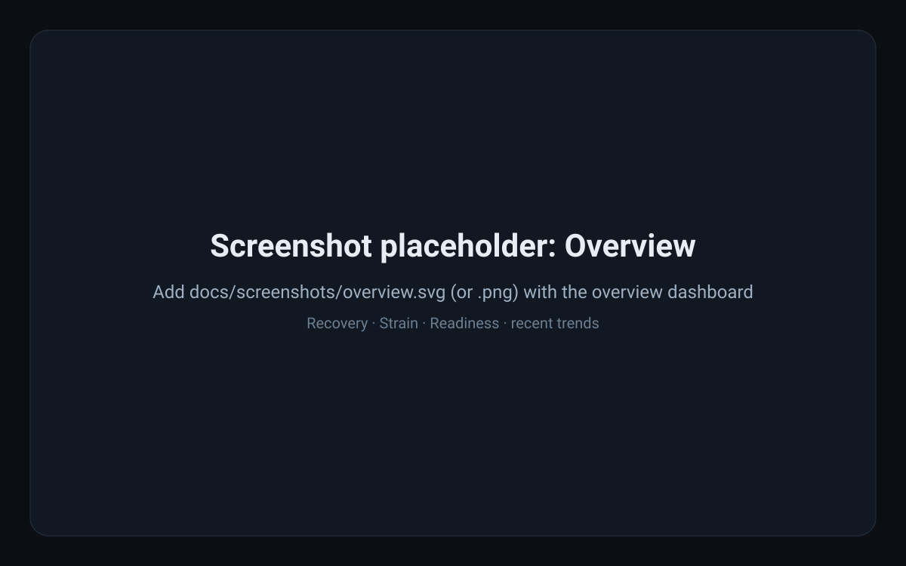
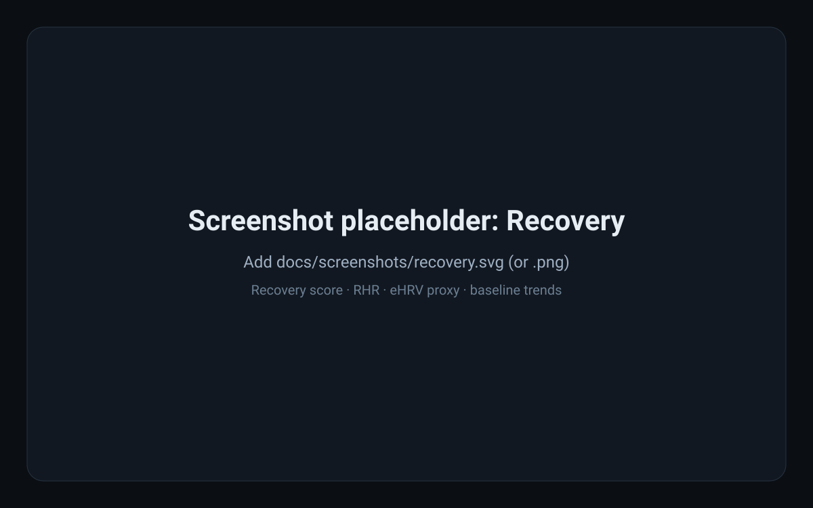
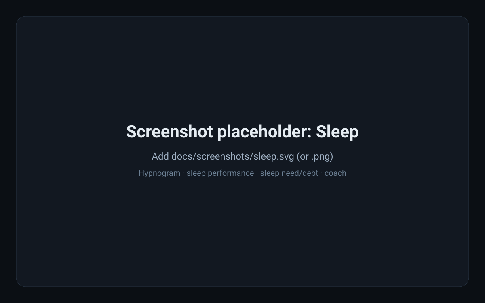
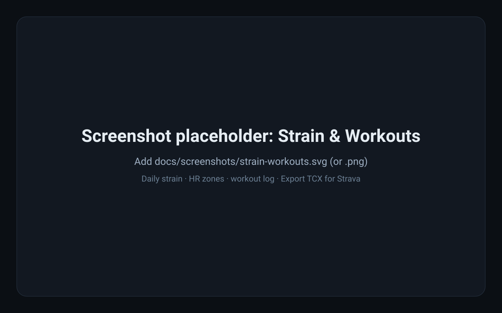
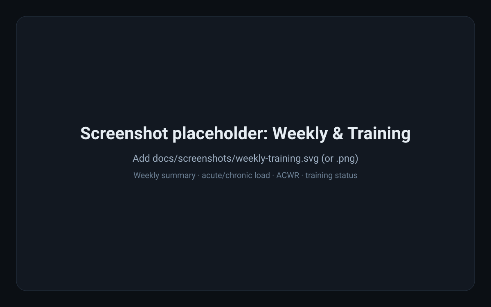
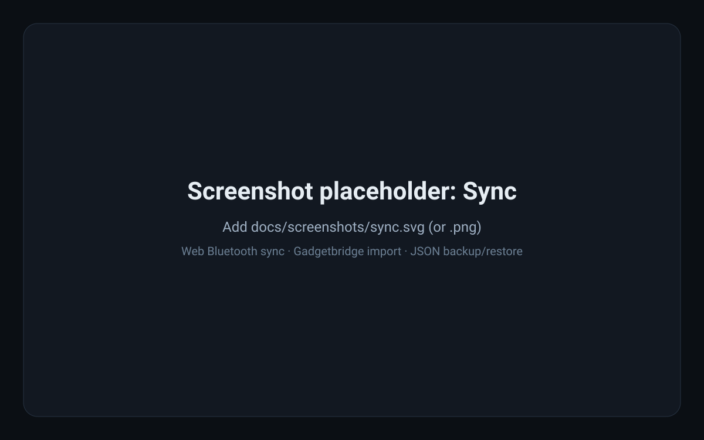

# noop-cmf

**Local-first, Whoop-style physiological analytics for the Nothing CMF Watch Pro 2.**

noop-cmf is an open-source TypeScript monorepo and Next.js PWA that syncs data from a CMF watch (via **Web Bluetooth** or a **Gadgetbridge** SQLite export), stores everything **locally in your browser (IndexedDB)**, and computes recovery, strain, sleep, readiness, training load, and workout insights — **no backend, no accounts, no telemetry**.

The goal is to give CMF watch owners deeper, private, own-your-data analytics (in the spirit of Whoop-style insights) without vendor lock-in, and to grow this into a community-driven open-source project. If you have a CMF watch, try it, break it, and help make it better.

**Try it now:** [noop-cmf-wheat.vercel.app](https://noop-cmf-wheat.vercel.app/) — open in a **Chromium-based browser** (desktop or Android) for Web Bluetooth sync. (iOS browsers don’t support Web Bluetooth; see [compatibility](#supported-devices--compatibility) and [using with the official Nothing/CMF app](#important-using-with-the-official-nothingcmf-app).)

> **Status:** active development / early but usable. Core sync, analytics, backup, and the PWA work; workout decoding, GPS, and some protocol details are still being validated and improved against real hardware. Contributions and real-device feedback are very welcome.

## Screenshots

> These are placeholders — replace them with real screenshots/photos of your dashboard in [`docs/screenshots/`](docs/screenshots/) (same filenames, `.svg` or `.png`). PRs with real screenshots are especially welcome.

| Overview | Recovery | Sleep |
| --- | --- | --- |
|  |  |  |

| Strain & Workouts | Weekly & Training | Sync & Import |
| --- | --- | --- |
|  |  |  |

## What this project does

- **Syncs your watch data** into the browser over Web Bluetooth (Chromium) or by importing a Gadgetbridge `.db` export.
- **Stores data locally** in IndexedDB (Dexie) — your health data stays on your device by default.
- **Computes analytics client-side** (pure TypeScript): recovery/readiness, strain and HR zones, sleep analysis and sleep need, training load, weekly summaries, habits, and more.
- **Exports and integrates:** full JSON backup/restore, and **per-workout TCX export** you can manually upload to Strava (works for GPS-less workouts with available HR/duration data; GPS tracks can be included when available).
- **Runs as a PWA** with an offline-capable app shell and install prompt.

## Features

### Data sync & storage
- **Web Bluetooth sync** with CMF Watch Pro 2 (pairing/auth and on-demand fetch).
- **Gadgetbridge SQLite import** (`.db` file drop/select).
- **JSON export/import** for full backup and restore (imports **merge** into local data, so repeated syncs/imports accumulate history).
- **Watch simulator (demo mode):** seed temporary sample data to explore the dashboard without a watch; turning it off removes only the simulator demo data and leaves your synced/imported data intact.
- **Local-first storage** in browser IndexedDB (Dexie).
- **PWA** with offline-capable shell and install prompt.

### Analytics & insights
- **Recovery (1–99):** from overnight HR/stress vs a rolling ~30-day baseline, with resting heart rate (RHR) and an eHRV proxy.
- **Readiness / time-to-recovery:** decaying readiness after strain with a “ready to go” countdown.
- **Strain (0–21):** daily load from Banister TRIMP and HR zones, zone breakdown, intensity minutes, and per-workout TRIMP/HR stats.
- **Sleep:** hypnogram, total sleep, sleep performance, dynamic sleep need/debt, sleep coach (recommended bedtime), and consistency.
- **Training load:** acute (7-day) vs chronic (28-day) load, ACWR, and training status (productive/maintaining/overreaching/detraining).
- **Weekly summary:** per-week strain, sleep, steps, energy, and watch wear time.
- **Trends & monitoring:** RHR trend, baseline bands, stress trend, health monitor/energy.
- **Habits & journal:** morning journal and habit-impact view.
- **VO₂ max estimator:** Cooper (12-min run) and Rockport (1-mile walk) tests with fitness category.

### Workouts & Strava
- **Workouts log:** synced workout sessions with time, duration, TRIMP/strain, and HR stats computed from samples in the workout window.
- **Export TCX for Strava:** download a Garmin TCX file per workout from the **Workouts** page and upload it manually to [Strava](https://www.strava.com/upload/select). Exports include duration and HR trackpoints/stats when available and work for **GPS-less** workouts; GPS route data can be attached when GPS capture is fully wired (in progress). No Strava account linking or backend required.

## How it works (architecture & data flow)

Everything runs in the browser — there is no server-side component for your data:

1. **Data sources**
   - **Web Bluetooth:** `@noop-cmf/cmf-ble` implements the CMF BLE protocol (transport/session, framing, AES pairing/auth, on-wire decoders) to fetch HR, stress, SpO₂, sleep, steps, workouts, and related records from the watch on demand.
   - **Gadgetbridge import:** the Gadgetbridge SQLite provider parses a `.db` export in-browser (sql.js/wasm) into the same domain records.
   - **JSON import:** restores/merges a previously exported snapshot.
2. **Local storage:** records are validated and persisted in **IndexedDB** via Dexie (`apps/web/src/db`). Sync/import operations merge with existing data.
3. **Analytics engine:** `@noop-cmf/physio-engine` computes derived metrics (TRIMP/strain, rolling-baseline recovery and eHRV proxy, sleep analysis/need, readiness decay, training load/ACWR, habits impact, etc.) from stored samples. `@noop-cmf/types` provides Zod schemas, branded primitives, and `Result<T,E>` contracts at boundaries.
4. **UI:** the Next.js 15 PWA (`apps/web`, App Router, React 19, Tailwind v4) renders dashboards and pages from local data: Overview, Recovery, Strain, Sleep, Weekly, Training, Workouts, Journal, VO₂ Max, Sync, and more.
5. **Exports:** JSON backup downloads all local tables; TCX export builds a Garmin TCX file client-side from a workout and its HR samples for manual Strava upload.

### Monorepo structure

```text
noop-cmf/
├─ apps/
│  └─ web/                 # Next.js 15 PWA (App Router, React 19, Tailwind v4, Dexie)
├─ packages/
│  ├─ types/               # Zod schemas, branded primitives, Result<T,E>, provider contracts
│  ├─ physio-engine/       # Strain, recovery/eHRV, sleep, readiness, habits, training-load math
│  ├─ cmf-ble/             # WebBLE transport/session, AES auth, wire decoders, Gadgetbridge parser
│  └─ watch-simulator/     # Seeded 30-day biometric data generator
├─ docs/screenshots/       # README/dashboard screenshots (placeholders — add real ones!)
├─ .github/workflows/ci.yml
├─ turbo.json
└─ pnpm-workspace.yaml
```

## Supported devices & compatibility

| | Support / notes |
| --- | --- |
| **Watch** | **Nothing CMF Watch Pro 2** (primary target). Other CMF models (e.g. Watch Pro 3) are untested/planned — reports welcome. |
| **Web Bluetooth sync** | **Chromium-based browsers** on desktop and Android (Chrome, Edge, etc.). **iOS browsers do not support Web Bluetooth** (Safari/Chrome on iPhone/iPad can’t do BLE sync). Brave/hardened browser configs may disable Web Bluetooth. |
| **Gadgetbridge import** | Gadgetbridge SQLite `.db` exports (works anywhere you can load the file in the browser). |
| **Strava** | Manual **TCX file upload** (no account linking, no backend). |
| **Hosting** | Runs locally (`next dev`) or deployed (e.g. Vercel or any host compatible with Next.js). |

## Getting started

### Try the hosted app (no install)
You can try noop-cmf without setting up a dev environment at **[noop-cmf-wheat.vercel.app](https://noop-cmf-wheat.vercel.app/)**. Use a **Chromium-based browser** (Chrome/Edge on desktop or Android) for Web Bluetooth sync. Your data stays in your browser’s local storage (IndexedDB) — the hosted app has no backend or telemetry. You can also import Gadgetbridge `.db` exports or JSON backups there.

### Prerequisites (for local development)
- **Node.js** >= 20
- **pnpm** >= 9 (repo uses `pnpm@11.x` via `packageManager`)
- A **Chromium-based browser** (desktop or Android) for Web Bluetooth sync, or a Gadgetbridge `.db` export

### Install & run locally

```bash
git clone https://github.com/codeSpicer/noop-cmf.git
cd noop-cmf
pnpm install

# run the web app
pnpm --filter web dev
```

Open [http://localhost:3000](http://localhost:3000).

### Build, lint, typecheck, test

```bash
# Full repo gate (Turbo)
pnpm turbo run build typecheck lint test

# Web app only
pnpm --filter web build
pnpm --filter web typecheck
pnpm --filter web lint
pnpm --filter web test

# E2E (Playwright)
pnpm --filter web test:e2e

# Format
pnpm format        # write
pnpm format:check  # check
```

## How to use

1. **Open the app** in a supported browser (Chromium on desktop/Android) — locally or a deployed instance — and go to **Sync**.
2. **Try the demo (no watch needed):** on **Sync**, use **Simulator mode** to seed temporary sample data and explore the dashboard. Turning it off removes only the simulator demo data — your synced/imported data stays intact.
3. **Sync from the watch (Web Bluetooth):** click **Connect & sync** and grant Bluetooth permission when prompted. Data is fetched and merged into local storage (repeated syncs accumulate; they don’t wipe existing data).
4. **Or import Gadgetbridge data:** on **Sync**, drop/select a Gadgetbridge SQLite `.db` export to import historical samples.
5. **Back up / restore:** use **Export data (JSON)** for a full snapshot and **Import data (JSON)** to restore/merge (recommended before clearing browser data or moving devices/browsers).
6. **Explore analytics:** Overview, Strain, Recovery, Sleep, Weekly, Training, Workouts, Journal, and VO₂ Max pages visualize metrics computed from your locally stored data.
7. **Export a workout to Strava:** open **Workouts**, click **Export TCX** on a workout to download a `.tcx` file, then upload it at [strava.com/upload/select](https://www.strava.com/upload/select). Works for GPS-less workouts (duration/HR when available).

## Important: using with the official Nothing/CMF app

This comes up often, so please read before your first sync:

- **You do NOT need to uninstall the official Nothing/CMF Watch app.** In most cases you should keep it installed. noop-cmf is a companion for analytics/export — it **does not** replace the official app for **call and notification mirroring, watch faces, alarms/settings, or firmware updates**.
- **BLE connection contention (the big one):** a watch typically allows only **one active BLE connection/app relationship at a time**. If the official app (or your phone system) is actively connected to the watch, the browser may fail to find or connect to it during Web Bluetooth sync.
- **If “Connect & sync” can’t find or connect to your watch:** try closing or force-stopping the official Nothing/CMF app, and/or temporarily **disconnecting/unpairing (“Forget”) the watch** from the official app and your phone’s Bluetooth settings so the browser can discover and connect to it. After syncing with noop-cmf, you can reconnect/pair it back with the official app for calls/notifications/firmware as needed.
- **Exact behavior varies** by phone, OS, browser, and watch firmware. If you have to fully remove/unpair from the official app to sync, that’s a device/OS Bluetooth limitation (not a goal of this project) — please share what worked for you in an issue so we can improve these docs.
- **iPhone/iPad:** browser Web Bluetooth is unavailable on iOS, so direct BLE sync from an iOS browser isn’t possible today. You can still use Gadgetbridge exports as a data source where applicable.

## Project status & vision (what we’re building)

**Where we are now:** a working local-first web app that can sync/import CMF watch data, compute Whoop-style metrics (recovery, strain, sleep, readiness, training load, etc.), and export workouts to Strava via TCX — all in-browser with no backend.

**What we’re trying to do:** make this the best open, private, hackable companion analytics app for CMF watches — accurate physiology, great UX, and easy ways to get your data out (Strava and beyond) — driven by the community.

**Help wanted / areas to grow (great for contributors):**
- **Protocol & device support:** validate and improve BLE decoding/pairing/fetch on real CMF Watch Pro 2 hardware; expand/verify support for other CMF models.
- **Workouts & GPS:** refine workout decoding, end-to-end GPS capture/association/validation, and richer activity exports (GPS tracks, distance/pace).
- **Analytics quality:** tune models, baselines, and edge cases with more real-world data/feedback.
- **UX & visualization:** dashboard polish, accessibility, mobile experience, and more insightful views.
- **Strava & integrations:** improve TCX/sport mapping; explore (opt-in) one-tap Strava upload via a minimal backend *without* moving health metrics to the cloud.
- **Docs & testing:** setup guides, device/browser compatibility reports, screenshots, and automated tests.

If you own a CMF watch, trying the app and reporting what works/doesn’t (device, browser, firmware, steps) is hugely valuable even if you don’t write code.

## Contributing

Contributions of all kinds are welcome — code, bug reports, protocol findings, device testing, docs, and screenshots.

- **Try it & report issues:** open an issue with your watch model, firmware (if known), browser/OS, what you tried, and what happened (logs/screenshots help). For sync/protocol issues, note whether the official app was connected.
- **Share screenshots/photos:** replace the placeholders in `docs/screenshots/` with real dashboard captures.
- **Pick up or propose work:** open an issue/PR for bugs, features, or the “help wanted” areas above. Keep changes focused and run the relevant checks before submitting.
- **Before opening a PR:** run lint/typecheck/tests for what you changed (see [Build, lint, typecheck, test](#build-lint-typecheck-test)). CI runs lint, typecheck, tests/coverage, and E2E builds.

## Privacy

All health data is processed and stored **locally in your browser’s IndexedDB**. There is **no backend service and no telemetry**. JSON/TCX exports (and any files you import) remain under your control. If future opt-in integrations are added (e.g. direct Strava upload), they should be explicit and designed to keep your metrics local by default.

## Limitations & known issues

- **No Web Bluetooth on iOS browsers:** direct watch sync isn’t available on iPhone/iPad browsers; a native wrapper (e.g. Capacitor) would be needed for BLE on iOS.
- **BLE contention:** sync can conflict with an active connection from the official Nothing/CMF app (see [Important: using with the official Nothing/CMF app](#important-using-with-the-official-nothingcmf-app)).
- **No call/notification mirroring:** noop-cmf does not forward calls/notifications to the watch — keep the official app for that.
- **Protocol/workout decoding is evolving:** some fetch payloads, workout details, and GPS data are still being refined/validated on real devices.
- **Baselines need history:** recovery/readiness metrics become more meaningful as you accumulate days of data (rolling baselines).
- **Browser quirks:** Brave and some hardened/privacy configurations may block Web Bluetooth.

## Disclaimer

This is an independent, community, reverse-engineering project and is **not affiliated with, endorsed by, or supported by Nothing, CMF, Whoop, or Strava**. Use at your own risk; behavior may vary by device, firmware, browser, and OS.

## License

This project is licensed under the [MIT License](LICENSE). (Added so contributors and users can confidently use and contribute to the project.)
